

<picture><source media="(prefers-color-scheme: dark)" srcset="assets/hero-dark.svg"></picture>

<picture><source media="(prefers-color-scheme: dark)" srcset="assets/social-l-dark.svg"></picture><a href="https://github.com/rizitakanashi-dev"><picture><source media="(prefers-color-scheme: dark)" srcset="assets/social-1-dark.svg"></picture></a><a href="https://discord.com/users/rizi00"><picture><source media="(prefers-color-scheme: dark)" srcset="assets/social-2-dark.svg"></picture></a><a href="https://instagram.com/rizi.belajar_coding"><picture><source media="(prefers-color-scheme: dark)" srcset="assets/social-3-dark.svg"></picture></a><a href="https://wa.me/6283877800002"><picture><source media="(prefers-color-scheme: dark)" srcset="assets/social-4-dark.svg"></picture></a><a href="mailto:rizitakanashi@gmail.com"><picture><source media="(prefers-color-scheme: dark)" srcset="assets/social-5-dark.svg"></picture></a><picture><source media="(prefers-color-scheme: dark)" srcset="assets/social-r-dark.svg"></picture>

<picture><source media="(prefers-color-scheme: dark)" srcset="assets/about-dark.svg"></picture>

<picture><source media="(prefers-color-scheme: dark)" srcset="assets/stack-dark.svg"></picture>

<a href="https://github.com/rizitakanashi-dev/steampreneur-agri-sort-ai"><picture><source media="(prefers-color-scheme: dark)" srcset="assets/project-steampreneur-agri-sort-ai-dark.svg"></picture></a>&nbsp;<a href="https://github.com/rizitakanashi-dev/Rexizo-Assistant"><picture><source media="(prefers-color-scheme: dark)" srcset="assets/project-rexizo-assistant-dark.svg"></picture></a>

<a href="https://github.com/rizitakanashi-dev/Absensi-Tefa"><picture><source media="(prefers-color-scheme: dark)" srcset="assets/project-absensi-tefa-dark.svg"></picture></a>&nbsp;<a href="https://github.com/rizitakanashi-dev/AT-Frontend"><picture><source media="(prefers-color-scheme: dark)" srcset="assets/project-at-frontend-dark.svg"></picture></a>

<picture><source media="(prefers-color-scheme: dark)" srcset="assets/stats-dark.svg"></picture>

<picture><source media="(prefers-color-scheme: dark)" srcset="assets/streak-dark.svg"></picture>

<picture><source media="(prefers-color-scheme: dark)" srcset="assets/wave-dark.svg"></picture>

<a href="https://github.com/rizitakanashi-dev"><picture><source media="(prefers-color-scheme: dark)" srcset="assets/button-1-dark.svg"></picture></a>&nbsp;&nbsp;<a href="mailto:rizitakanashi@gmail.com"><picture><source media="(prefers-color-scheme: dark)" srcset="assets/button-2-dark.svg"></picture></a>&nbsp;&nbsp;<a href="https://github.com/rizitakanashi-dev?tab=repositories"><picture><source media="(prefers-color-scheme: dark)" srcset="assets/button-3-dark.svg"></picture></a>

<a href="https://metawka.github.io/expressive-profile/?from=rizitakanashi-dev"><picture><source media="(prefers-color-scheme: dark)" srcset="assets/credit-dark.svg"></picture></a>

