<picture><source media="(prefers-color-scheme: dark)" srcset="assets/hero-dark.svg"></picture>

<picture><source media="(prefers-color-scheme: dark)" srcset="assets/social-l-dark.svg"></picture><a href="https://github.com/[YOUR GITHUB USERNAME]"><picture><source media="(prefers-color-scheme: dark)" srcset="assets/social-1-dark.svg"></picture></a><a href="https://linkedin.com/in/[YOUR LINKEDIN USERNAME]"><picture><source media="(prefers-color-scheme: dark)" srcset="assets/social-2-dark.svg"></picture></a><a href="mailto:[YOUR EMAIL]"><picture><source media="(prefers-color-scheme: dark)" srcset="assets/social-3-dark.svg"></picture></a><a href="[YOUR PORTFOLIO URL]"><picture><source media="(prefers-color-scheme: dark)" srcset="assets/social-4-dark.svg"></picture></a><a href="https://kaggle.com/[YOUR KAGGLE USERNAME]"><picture><source media="(prefers-color-scheme: dark)" srcset="assets/social-5-dark.svg"></picture></a><picture><source media="(prefers-color-scheme: dark)" srcset="assets/social-r-dark.svg"></picture>

<picture><source media="(prefers-color-scheme: dark)" srcset="assets/about-dark.svg"></picture>

<picture><source media="(prefers-color-scheme: dark)" srcset="assets/stack-dark.svg"></picture>

<a href="https://github.com/[YOUR GITHUB USERNAME]/[PROJECT 01 REPO]"><picture><source media="(prefers-color-scheme: dark)" srcset="assets/project-project-01-dark.svg"></picture></a>&nbsp;<a href="https://github.com/[YOUR GITHUB USERNAME]/[PROJECT 02 REPO]"><picture><source media="(prefers-color-scheme: dark)" srcset="assets/project-project-02-dark.svg"></picture></a>

<a href="https://github.com/[YOUR GITHUB USERNAME]/[PROJECT 03 REPO]"><picture><source media="(prefers-color-scheme: dark)" srcset="assets/project-project-03-dark.svg"></picture></a>

<picture><source media="(prefers-color-scheme: dark)" srcset="assets/stats-dark.svg"></picture>

<picture><source media="(prefers-color-scheme: dark)" srcset="assets/streak-dark.svg"></picture>

<picture><source media="(prefers-color-scheme: dark)" srcset="assets/wave-dark.svg"></picture>

<a href="[YOUR PORTFOLIO URL]"><picture><source media="(prefers-color-scheme: dark)" srcset="assets/button-1-dark.svg"></picture></a>&nbsp;&nbsp;<a href="mailto:[YOUR EMAIL]"><picture><source media="(prefers-color-scheme: dark)" srcset="assets/button-2-dark.svg"></picture></a>&nbsp;&nbsp;<a href="https://github.com/[YOUR GITHUB USERNAME]?tab=repositories"><picture><source media="(prefers-color-scheme: dark)" srcset="assets/button-3-dark.svg"></picture></a>

<a href="https://metawka.github.io/expressive-profile/?from=%5BYOUR%20GITHUB%20USERNAME%5D"><picture><source media="(prefers-color-scheme: dark)" srcset="assets/credit-dark.svg"></picture></a>

